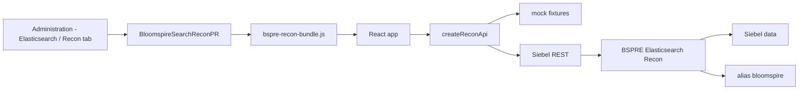

# Architecture

Recon is a Siebel Open UI physical renderer plus a React application. The renderer mounts the React bundle in the view tab. The React application talks only to a Siebel business service. That service is the only component that reads Siebel data and the search index.

## Renderer lifecycle

`BloomspireSearchReconPR.js` follows the same lifecycle as Global Search.

1. Siebel loads `siebel/custom/bspre-recon-bundle.js`, then the renderer module `siebel/custom/BloomspireSearchReconPR`.
2. `ShowUI`, `BindEvents`, and a `BindData` refresh call the same ensure-host path.
3. The host is a single `div.bspre-recon-host` inserted after the applet div `#s_<GetFullId>_div`. The applet div is hidden.
4. The bundle's `mount(host, options)` renders the app and returns an unmount function.
5. `EndLife` calls that unmount, removes the host, and restores the applet div.
6. If `mount` is missing, a failed script tag is removed and the bundle URL is requested again.

The production bundle is a webpack UMD library named `BloomspireSearchRecon`. CSS is inlined by style-loader. Every selector is under `.bspre-recon-host`, so the app does not restyle the rest of the Siebel screen.

The dev server does not use that UMD entry. `npm start` loads `src/devIndex.js`, which draws a fake screen chrome (tabs Recon, Job Runs, Bulk Jobs) and mounts the same app inside the Recon tab.

## API choice

`src/api/reconApi.js` is the client interface:

- `listRuns`
- `getRun(runId)`
- `startRun({ recordTypes, options })`
- `pauseRun(runId)`
- `resumeRun(runId)`
- `getFindings(runId, { filters, page })`
- `compareRuns(baselineId, currentId)`
- `exportCsv(runId, { filters })`

`BSPRE_RECON_API` selects the implementation, the same way Global Search selects its client. `mock` is the default for `npm start` and for tests. `siebel` is the default for `npm run build`. The Siebel client posts to `/siebel/v1.0/service/BSPRE Elasticsearch Recon/<Method>` with `{"body": {...}}` and HTTP Basic auth when a username is configured.

## Record types and the index

There are three record types: Individual, Entity, and Opportunity. Display labels live in `RECORD_TYPES` in `src/config.js`. Opportunity's label is Lead.

Search documents live under one alias, `bloomspire`. A document has `record_type` and nested objects `individual`, `entity`, and `opportunity`. Each nested object has `id` (the Siebel ROW_ID, also the Elasticsearch `_id`) and `last_updated`. `last_updated` uses Siebel's clock format, for example `11/5/2025 11:41:37 AM`. Parsing is in `src/dates.js`. The string has no time zone. Siebel and the index must already use the same zone. The UI keeps the original text on screen.

## Checks

Each run can include all three record types. For every selected type the service classifies rows as:

- **Siebel only.** The row is in Siebel and missing from the index.
- **ES only.** The id is still in the index after it should have been removed, for example after a failed delete.
- **Stale.** The id is in both, and Siebel's last updated time is newer than the index `last_updated` by more than the run's tolerance in seconds.

Matched rows are counted and are not findings. Population counts follow:

- Siebel count = matched + Siebel only + stale
- ES count = matched + ES only + stale

## Runs

A run is `running`, `paused`, `done`, or `error`. A run that has not finished every chunk is `partial`. Running, paused, and error runs are partial. Partial runs are marked in the UI and `compareRuns` rejects them.

Pause and resume are for chunked work. The mock only changes status. It does not advance chunks by itself. Requeue and failure correlation are out of scope and have no controls.

## Compare and export

Compare keys a finding by `record_type + id + check`.

- **New** is in the current run only.
- **Resolved** is in the baseline run only.
- **Still open** is in both.

`src/compareFindings.js` is the rule the mock uses. The business service is expected to use the same key. CSV export uses the current findings filter and is not limited to the visible page. The builder is `src/csv.js`. The record type column stores `Opportunity`, not the Lead label.

## View detail

Each finding id links to the Siebel record in the same tab. `src/siebelDetailUrl.js` builds a same-origin URL under `/siebel/app/callcenter/enu`. `BSPRE_SIEBEL_APP_BASE` is an optional path prefix when the page is not served by Siebel. It is not the REST base URL.
